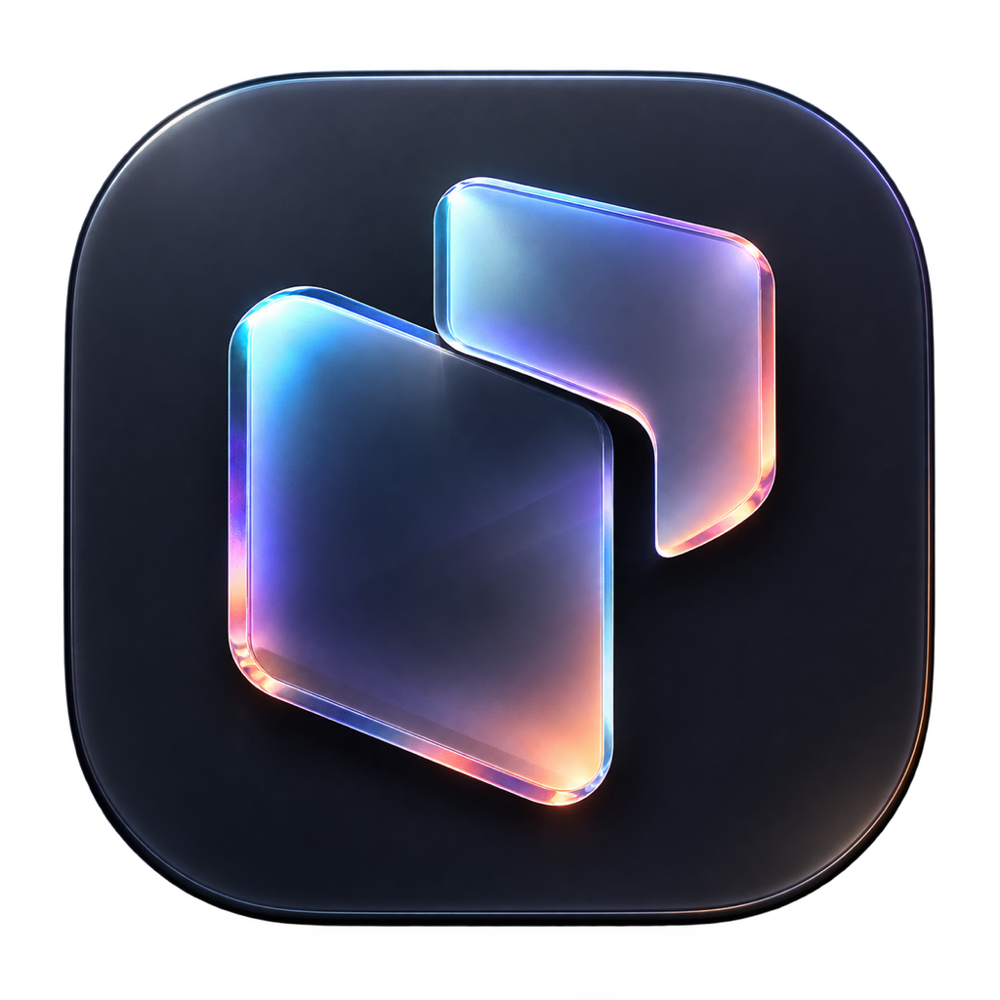
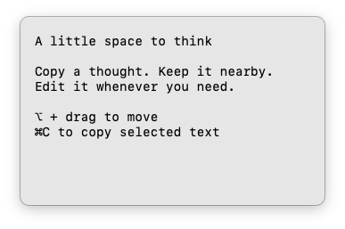
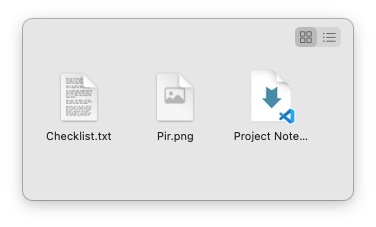

  

<h1 align="center">Pir</h1>

复制一下. 贴在屏幕上.

  <a href="https://pir.caldis.me/">官网</a> ·
  <a href="https://github.com/Caldis/Pir/releases/latest">下载</a>

<a href="README.md">English</a> · 简体中文

Pir 是原生 macOS 菜单栏应用, 将剪贴板图片、可编辑文本与文件引用贴在无边框置顶浮窗中. 自由移动和调整每个浮窗的大小, 把所需内容留在手边.

## 功能

### 图片

- 贴出剪贴板中的图片, 支持透明图片, Retina 截图保留逻辑显示尺寸.
- 在裁剪填满窗口与完整等比显示之间切换. 窗口尺寸和位置保持不变; 显示模式会保存, 再次贴上也会沿用.
- 从浮窗复制原始图片.

### 文本

- 直接在浮窗中选择、编辑和复制文字, 修改随 Pir 重启恢复.
- 拖动顶部留白移动窗口, 或按住 `Option` 拖动正文. 从边缘调整大小, 窄窗口保持换行并支持竖向滚动.
- 文字与背景颜色跟随 macOS 明暗主题. 新建贴屏去除首尾空白, 保留内部排版, 不改写剪贴板.

### 文件

- 在 Finder 中复制文件或文件夹, 贴出带原生图标或列表视图的文件引用.
- 支持相交框选、`Command` 切换选择、`Shift` 追加选择、双击打开, 以及拖到 Finder.
- 右键菜单提供打开、移到废纸篓、显示简介、重命名、在 Finder 中显示与从列表移除. 显示简介打开 Pir 的原生文件信息窗口, 字段支持选择与复制. 多文件重命名采用编号并保留扩展名.

**文件操作会影响源文件.** 重命名和移到废纸篓会同步更新各浮窗中的引用, 包含受影响目录内部的文件. 移到废纸篓只移除成功项及其目录后代引用. **从列表移除**只清理浮窗引用, 保留源文件; 移除最后一项后关闭浮窗.

## 开始使用

需要 **macOS 13 或更新版本**, 支持 Apple Silicon 与 Intel Mac.

[下载最新磁盘镜像](https://github.com/Caldis/Pir/releases/latest), 将 Pir 拖入 Applications, 然后打开并完成欢迎页. 可以在其中录制快捷键并试贴 Pir Logo.

1. **复制.** 复制图片、文字, 或 Finder 中的文件与文件夹.
2. **贴出.** 在任意应用中按 **`⇧⌘V`** (`Shift` + `Command` + `V`). 已保存的自定义快捷键继续生效.
3. **摆放.** 拖动浮窗调整位置, 从边缘调整大小, 悬停后显示左上角控件. 文本浮窗可拖动顶部留白, 或按住 `Option` 拖动正文.

| 内容 | 控件, 从左到右 |
| --- | --- |
| 图片 | 关闭、复原尺寸、显示模式、复制 |
| 文本 | 关闭、复原尺寸、复制 |
| 文件 | 关闭、复原尺寸 |

复制成功后, 按钮短暂显示勾号. 全局快捷键触发与快捷键录制均免辅助功能权限.

## 偏好设置与恢复

点击菜单栏图标, 选择**偏好设置**. 四个页签为基础、贴屏、更新与关于.

| 基础设置 | 功能 |
| --- | --- |
| 开机启动 | 登录 macOS 时启动 Pir |
| 隐藏菜单栏图标 | 隐藏图标; 再次打开 Pir 可进入偏好设置 |
| 快捷键 | 录制或清除用于贴出内容的全局快捷键 |

**贴屏**页列出全部浮窗, 支持再次贴上、显示、隐藏、删除与确认后清空全部. 隐藏状态随重启保留. Pir 重启时恢复贴屏内容、尺寸与位置, 多显示器位置按屏幕归属保存.

完成入门后, 常规启动保持静默. 应用运行时再次打开 Pir 会显示偏好设置, 隐藏菜单栏图标后也可使用此入口. 在**更新**页可以手动检查新版本, 或开启启动时检查. 更新通过 Sparkle 获取, 来自 Pir 的 GitHub Releases.

## 本地存储与隐私

Pir 在用户触发时读取剪贴板. 贴屏会话保存在本机 `~/.config/pir/`, 关闭浮窗时清理对应保存记录. 文件贴屏保留文件 URL 引用. 关闭文件浮窗或移除引用不会删除源文件; **移到废纸篓**会操作源文件.

## 许可

Pir 使用 [Pir Source License 1.0](LICENSE), 属于**源码可用**许可. 遵守条款即可使用、复制、修改与分发, 包括出售副本. 副本必须保留完整许可与版权声明; 修改后的发行版须标明更改, 且不得冒充 Pir 官方发行版.

通过应用商店分发许可定义的适用应用, 无论免费或付费, 均需获得 Caldis / BIAO CHEN 的单独书面授权. 适用应用与应用商店的范围以许可定义为准; 版权持有人保留自身发行权利. 此许可**不是 MIT 许可, 也不是 OSI 批准的开源许可**. 第三方组件保留各自许可, 见[第三方声明](THIRD_PARTY_NOTICES.md).
